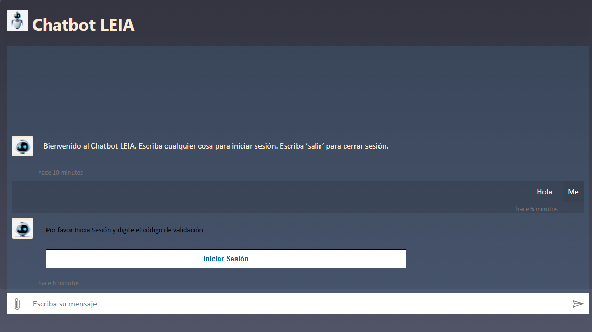
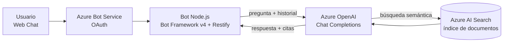

# Azure RAG Chatbot

Chatbot corporativo que responde preguntas **en base a los documentos de la empresa**, con inicio de sesión obligatorio y referencias a los archivos de donde sale cada respuesta.

Usa el patrón **RAG** (Retrieval-Augmented Generation): en cada pregunta, Azure OpenAI consulta un índice de **Azure AI Search** con los documentos cargados y responde solo con esa información, citando las fuentes.



## Qué hace

- **Inicio de sesión con OAuth** (Azure Bot Service): el usuario se autentica antes de poder preguntar, y escribe `salir` para cerrar sesión.
- **Respuestas basadas en documentos propios**: el modelo responde solo con el contenido indexado (`in_scope`), en español.
- **Referencias**: cada respuesta lista los documentos citados (`[doc1] : archivo.pdf`).
- **Memoria de conversación**: mantiene las últimas 5 preguntas como contexto.
- **Web chat incluido**: la ruta `/` sirve una página con Bot Framework Web Chat conectada por Direct Line.

## Arquitectura



## Stack

- **Node.js** · Bot Framework SDK v4 (`botbuilder`, `botbuilder-dialogs`) · Restify · Axios
- **Azure Bot Service** (canal Web Chat / Direct Line, conexión OAuth)
- **Azure OpenAI** (GPT-4o) con *On Your Data*
- **Azure AI Search** (búsqueda semántica sobre los documentos)
- **Azure App Service** para el despliegue (plantillas ARM en `deploymentTemplates/`)

## Estructura

```
├── index.js               # Servidor Restify, adaptador del bot y página de Web Chat
├── bots/
│   ├── dialogBot.js       # Manejo de mensajes y guardado de estado
│   └── authBot.js         # Bienvenida y eventos de token OAuth
├── dialogs/
│   ├── mainDialog.js      # Login OAuth + consulta RAG a Azure OpenAI / AI Search
│   └── logoutDialog.js    # Cierre de sesión con "salir"
└── deploymentTemplates/   # Plantillas ARM para Azure
```

## Configuración

Variables de entorno (archivo `.env` en la raíz):

| Variable | Para qué sirve |
|---|---|
| `MicrosoftAppType`, `MicrosoftAppId`, `MicrosoftAppPassword`, `MicrosoftAppTenantId` | Identidad del bot en Azure |
| `connectionName` | Nombre de la conexión OAuth configurada en Azure Bot Service |
| `DIRECT_LINE_TOKEN` | Token del canal Direct Line para el Web Chat |
| `OPENAI_API_URL`, `OPENAI_API_KEY` | Endpoint de Chat Completions del deployment de Azure OpenAI y su clave |
| `SEARCH_ENDPOINT`, `SEARCH_KEY`, `SEARCH_INDEX_NAME` | Servicio e índice de Azure AI Search |

> El `.env` del repositorio es solo una plantilla vacía: no subas tus claves.

## Ejecutar en local

Requiere Node.js 18 o superior.

```bash
git clone https://github.com/josemurgadev/azure-rag-chatbot.git
cd azure-rag-chatbot
npm install
npm start
```

El bot queda en `http://localhost:3978`. Para probarlo:

- **Bot Framework Emulator**: *Open Bot* → `http://localhost:3978/api/messages`.
- **Web Chat**: abre `http://localhost:3978` (requiere `DIRECT_LINE_TOKEN`).

## Despliegue en Azure

1. Crear el índice en Azure AI Search con los documentos (por ejemplo, desde Blob Storage).
2. Crear el deployment del modelo en Azure OpenAI.
3. Desplegar el App Service y el Azure Bot con las plantillas de `deploymentTemplates/` (las instrucciones están en el `readme.md` de cada carpeta).
4. Configurar la conexión OAuth en el Azure Bot y las variables de entorno en el App Service.

## Créditos

La base de autenticación parte del ejemplo [18.bot-authentication](https://github.com/microsoft/BotBuilder-Samples) de Microsoft Bot Framework (licencia MIT). La integración RAG con Azure OpenAI y Azure AI Search, el manejo del historial, las referencias y el Web Chat son desarrollo propio.

---

Desarrollado por **José Murga** · [josemurga.dev](https://josemurga.dev)
